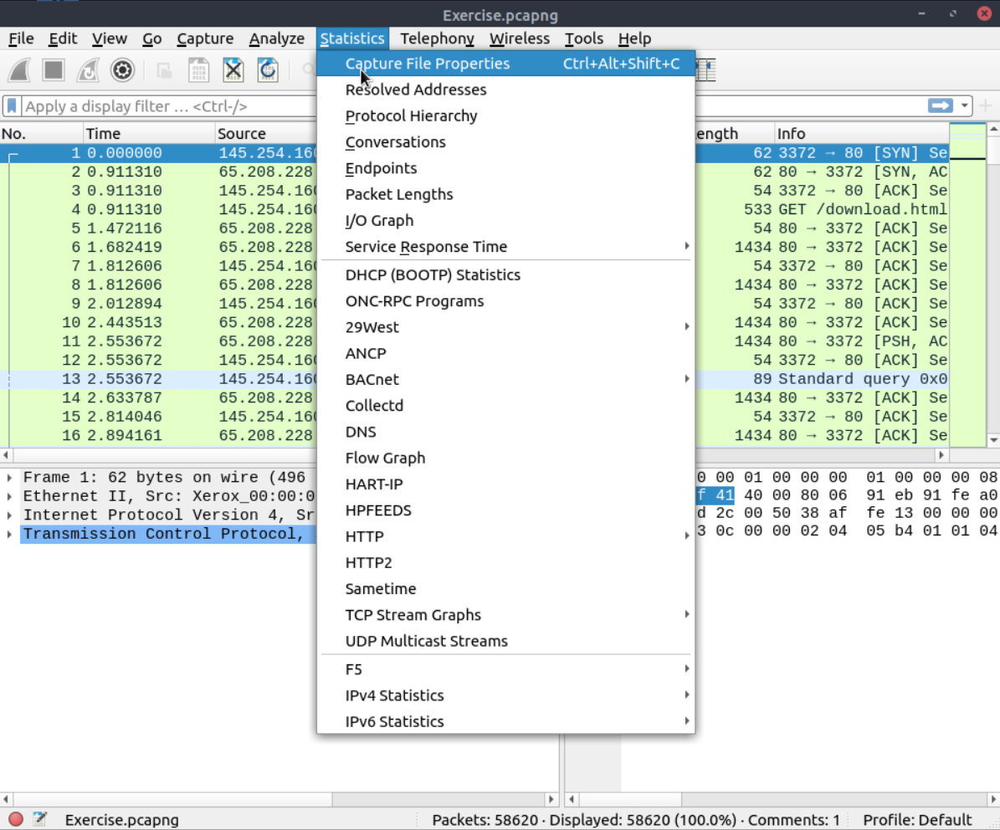

# Lab Report: Wireshark: The Basics (TryHackMe)

| | |
|---|---|
| **Platform** | TryHackMe |
| **Room** | Wireshark: The Basics |
| **Category** | Network Traffic Analysis |
| **Difficulty** | Easy |
| **Tools** | Wireshark, Linux terminal (`md5sum`) |
| **Date Completed** | 9-22-2026 |
| **Author** | Colton Bayne |

> **Note:** In line with TryHackMe's guidance, flags and exact answers are redacted. This report focuses on methodology and what each technique is useful for in a real analyst workflow.

---

## Summary

This lab introduced Wireshark as a packet analysis tool by working through a provided capture file (`Exercise.pcapng`). I practiced verifying capture metadata, dissecting individual packets layer by layer, searching for and extracting data from traffic, and narrowing large captures with display filters and stream reconstruction. The capture contained roughly 58,000 packets of mostly HTTP traffic, which made it a good environment for learning how an analyst moves from "too much data" to a specific finding.

## Objectives

- Navigate the Wireshark interface (packet list, packet details, and packet bytes panes)
- Review capture file metadata and verify file integrity
- Interpret protocol headers across the network, transport, and application layers
- Locate strings, comments, and files embedded in traffic
- Extract and hash an object carried over the network
- Use Expert Info, display filters, and stream following to focus an investigation

## Lab Environment

The room VM provided two capture files:

- `http1.pcapng`: used only to follow along with the room's example screenshots
- `Exercise.pcapng`: the capture analyzed for all findings in this report

---

## Methodology and Findings

### 1. Capture File Triage

Before looking at individual packets, I opened **Statistics > Capture File Properties** to get an overview of the evidence. This view reports the file's hashes, capture timeframe, interface details, packet totals, and any comments left by whoever recorded the capture.

From this panel I recorded:

- The analyst comment embedded in the file (contained the first flag): `[REDACTED]`
- The total packet count: `[REDACTED]`
- The SHA256 hash of the capture file: `[REDACTED]`

**Why it matters:** Recording a hash before analysis is basic evidence handling. It proves the file I analyzed is the same one that was collected, which is important if findings ever need to support an incident report or escalation.

