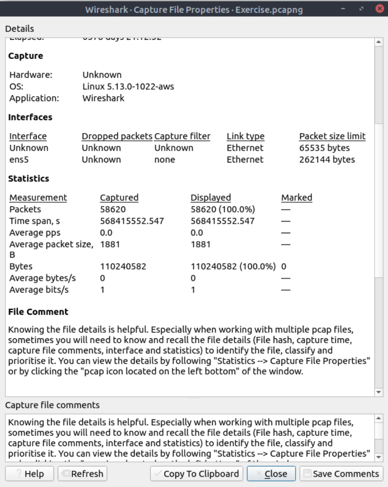

# Lab Report: Wireshark: The Basics (TryHackMe)

| | |
|---|---|
| **Platform** | TryHackMe |
| **Room** | Wireshark: The Basics |
| **Category** | Network Traffic Analysis |
| **Difficulty** | Easy |
| **Tools** | Wireshark, Linux terminal (`md5sum`) |
| **Date Completed** | 9-22-2026 |
| **Author** | Colton Bayne |

> **Note:** In line with TryHackMe's guidance, flags and exact answers are redacted. This report focuses on methodology and what each technique is useful for in a real analyst workflow.

---

## Summary

This lab introduced Wireshark as a packet analysis tool by working through a provided capture file (`Exercise.pcapng`). I practiced verifying capture metadata, dissecting individual packets layer by layer, searching for and extracting data from traffic, and narrowing large captures with display filters and stream reconstruction. The capture contained roughly 58,000 packets of mostly HTTP traffic, which made it a good environment for learning how an analyst moves from "too much data" to a specific finding.

## Objectives

- Navigate the Wireshark interface (packet list, packet details, and packet bytes panes)
- Review capture file metadata and verify file integrity
- Interpret protocol headers across the network, transport, and application layers
- Locate strings, comments, and files embedded in traffic
- Extract and hash an object carried over the network
- Use Expert Info, display filters, and stream following to focus an investigation

## Lab Environment

The room VM provided two capture files:

- `http1.pcapng`: used only to follow along with the room's example screenshots
- `Exercise.pcapng`: the capture analyzed for all findings in this report

---

## Methodology and Findings

### 1. Capture File Triage

Before looking at individual packets, I opened **Statistics > Capture File Properties** to get an overview of the evidence. This view reports the file's hashes, capture timeframe, interface details, packet totals, and any comments left by whoever recorded the capture.

From this panel I recorded:

- The analyst comment embedded in the file (contained the first flag): `[REDACTED]`
- The total packet count: `[REDACTED]`
- The SHA256 hash of the capture file: `[REDACTED]`

**Why it matters:** Recording a hash before analysis is basic evidence handling. It proves the file I analyzed is the same one that was collected, which is important if findings ever need to support an incident report or escalation.



### 2. Dissecting a Single Packet

Next I jumped to a specific HTTP packet (**Go > Go to Packet**, or `Ctrl+G`) and worked through its layers in the packet details pane.

| Field Examined | Where It Lives | What I Learned |
|---|---|---|
| Content type | HTTP layer | The HTTP response was carrying XML data |
| Arrival date | Frame metadata | Required changing **View > Time Display Format** to *Date and Time of Day*, since Wireshark defaults to seconds since capture start |
| TTL | IPv4 header | Shows how many router hops the packet had left before being discarded |
| TCP payload size | TCP header | Size of the application data carried in this segment, separate from header overhead |
| ETag | HTTP response headers | A server-assigned identifier for a specific version of a web resource, used for caching |

**Why it matters:** Seeing these fields in context made the OSI/TCP-IP model concrete. The time display setting was a practical lesson too: when correlating packet data with SIEM alerts or host logs, absolute timestamps (and knowing which time zone they're in) are what let you line events up.


### 3. Searching Traffic and Extracting Data

This section was the most investigation-like part of the lab.

**String search.** Using **Edit > Find Packet** (`Ctrl+F`), I set the search type to *String* and the scope to *Packet details*, then searched for a partial value. This landed on an XML field identifying an artist name in a web response.

**Packet comments and file extraction.** A comment attached to one packet (right-click > *Packet Comments*) pointed to a later packet containing a JPEG image. I selected the JPEG section in the packet details pane, used **Export Packet Bytes** to save it to disk, then hashed it from the terminal:

```bash
md5sum <exported_file>
```

The resulting MD5 matched the expected answer: `[REDACTED]`

**Recovering a transferred text file.** Searching the packet list for `.txt` turned up an HTTP `GET` request for a text file. Following it to the server's `200 OK` response showed the file content was sent in cleartext, so I exported it (**File > Export Objects > HTTP**) and read it. The file contained the name requested by the room: `[REDACTED]`

**Expert Info.** Finally, **Analyze > Expert Information** groups Wireshark's automated observations by severity (errors, warnings, notes, and chats). I recorded the number of warnings in the capture: `[REDACTED]`

**Why it matters:** Carving a file out of traffic and hashing it is the same workflow used to check a suspicious download against threat intelligence (for example, looking up the hash on VirusTotal). The cleartext `.txt` transfer also shows why unencrypted HTTP is a data exposure risk: anyone positioned on the network path can read it. Expert Info is a fast first pass for spotting retransmissions, malformed packets, and other anomalies in a large capture.


### 4. Filtering and Stream Reconstruction

**Display filters.** I right-clicked the HTTP layer of a packet and chose **Apply as Filter > Selected**, which generated the display filter:

```
http
```

The status bar then showed how many of the total packets matched. Building filters from existing packets is a useful way to learn filter syntax, since Wireshark writes the expression for you.

**Follow HTTP Stream.** On a later packet I used **Follow > HTTP Stream**, which reassembles the full request and response exchange into a readable conversation. Searching within the stream for "artist" let me count the artists returned by the web server and identify the second one: `[REDACTED]`

**Why it matters:** Filtering is how an analyst turns tens of thousands of packets into the handful that are relevant. Following a stream is often the quickest way to see exactly what a client asked for and what a server sent back, such as a malware download, a credential submission, or command-and-control traffic.


---

## Key Takeaways

- **Start with metadata.** Capture File Properties gives scope, timeframe, and integrity hashes before any deep analysis begins.
- **Time format matters.** Switching to absolute date and time is necessary for correlating packets with alerts and logs from other sources.
- **Protocol headers tell a story.** Fields like TTL, payload size, and HTTP headers provide context about the path, size, and nature of traffic.
- **Files can be carved from traffic.** Exporting objects and hashing them supports malware triage and threat intel lookups.
- **Cleartext protocols expose data.** Anything sent over plain HTTP can be read in full by anyone capturing the traffic.
- **Filter early, follow streams often.** Display filters and stream reconstruction are the core techniques for cutting a large capture down to what matters.

## SOC Relevance

These fundamentals map directly to Tier 1 SOC work. When an IDS or SIEM alert fires on network activity, an analyst frequently pulls the related PCAP to confirm whether the alert is a true positive, identify the hosts and data involved, and extract any transferred files for further analysis. This room built the Wireshark navigation habits that later rooms (Packet Operations, Traffic Analysis) build on for detecting scans, spoofing, and tunneling.

## Next Steps

- [ ] Wireshark: Packet Operations
- [ ] Wireshark: Traffic Analysis
- [ ] Apply these techniques to traffic generated in my home lab

## References

- [TryHackMe: Wireshark: The Basics](https://tryhackme.com/room/wiresharkthebasics)
- [Wireshark User's Guide](https://www.wireshark.org/docs/wsug_html_chunked/)
